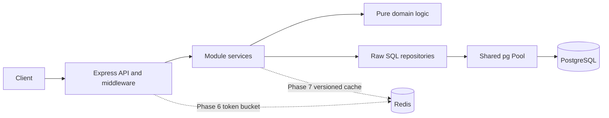

# Architecture and phase boundaries

The engine is one deployable process with modules for authentication, applications, rules, underwriting, manual reviews and audits. Controllers parse HTTP input; services coordinate use cases; domain functions calculate metrics and evaluate rules; repositories execute parameterized SQL. The rule engine will not import Express, pg or Redis.

Phase 1 implements the HTTP runtime, shared connection setup and operational endpoints. The diagram's business layers, token bucket and cache are future phases.

## Runtime behavior

The process validates configuration, creates one pool and Redis client, verifies PostgreSQL connectivity, then listens. Redis connects/reconnects in the background. PostgreSQL failure during startup exits with failure; Redis failure permits startup. Failed idle PostgreSQL clients have an error listener to prevent an unhandled error from terminating the process.

Liveness is independent of infrastructure. Readiness requires PostgreSQL, reports Redis degradation, and returns 503 during shutdown. Dependencies have connection and command/query timeouts. Redis commands use `executeRedisCommand` for an actual response deadline: the client's native command timeout only covers queued writes. A response timeout rejects the operation, destroys the connection to clear pending replies and reconnects in the background. The signal handler marks shutdown, stops accepting connections, drains HTTP, then closes Redis and PostgreSQL. A deadline bounds the shutdown.

Pino logs request ID, method, status and duration. Error messages, request paths, query strings, headers and bodies are excluded. UUID request IDs may be propagated; all other supplied IDs are replaced. Error responses never return stack traces or unexpected error messages.

## Trade-offs

The monolith is easy to run and keeps transactions local. Raw SQL makes joins, locks and constraints explicit, at the cost of manual row mapping and migration discipline. Redis is expendable supporting infrastructure. No business endpoint is exposed before authentication and authorization are implemented in their planned phases.

Future improvements include workload-specific pool tuning, metrics/tracing, secrets management, deployment-specific TLS/proxy configuration and backup/restore exercises. These are outside Phase 1.
