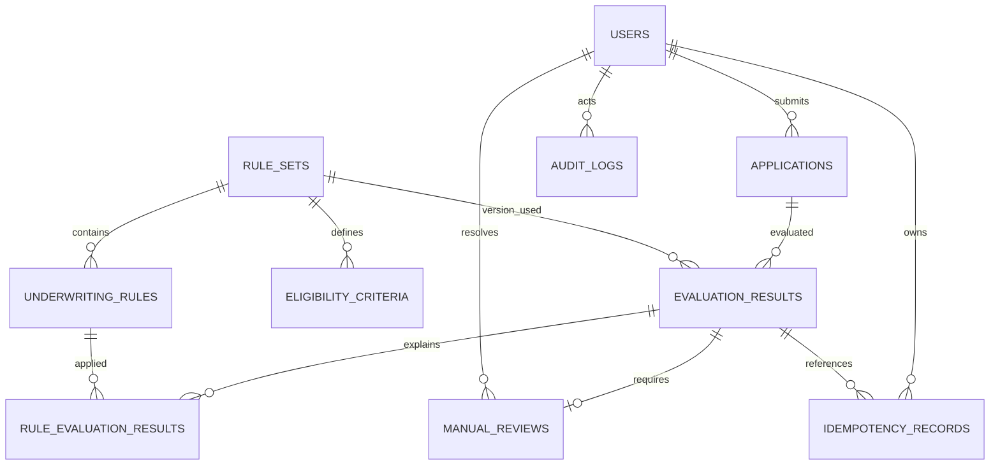

# Database design (planned for Phase 2)

No application schema or seed data exists in Phase 1. The current pool performs only a readiness SELECT 1. This ERD describes the intended relationships, not deployed tables.

See the [design entity table](superpowers/specs/2026-11-15-foundation-design.md) for initial columns. Use UUIDs, TIMESTAMPTZ, NUMERIC money, foreign keys, checks and indexes. Published rule versions must be immutable; a partial unique index permits only one active version per product.

## Repository and transaction contract

Use `pg` instead of an ORM to demonstrate SQL, connection ownership, locks and transactions directly. Bind input using placeholders (`WHERE id = $1`); whitelist any dynamic sort columns. Do not interpolate user input. Return explicitly mapped TypeScript values; keep NUMERIC strings or use decimal-safe arithmetic, never globally convert financial values to JavaScript floating point.

Standalone repositories can use the shared pool. Multi-write services will use a transaction helper that checks out a client, runs BEGIN, passes that exact client to every repository, commits on success, rolls back on failure and always releases in finally. `pool.query()` is forbidden for statements inside that transaction. Evaluation, individual rule results, review creation and idempotency records must commit atomically.

SQL migrations, transaction helpers, schema enforcement, repositories and rollback/concurrency tests are Phase 2 or later. No migration/seed command is advertised until implemented.
