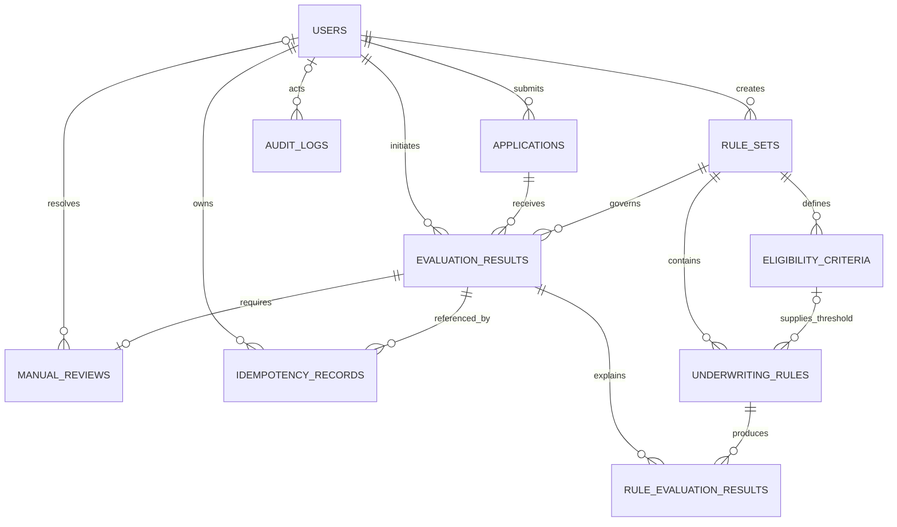

# Database design

## Feature 2.1: scope and implementation status

This document specifies the PostgreSQL schema for the Underwriting Decision Engine, an educational
backend using synthetic applications and illustrative policies. Feature 2.1 delivers the design only.
The tables, constraints, indexes and triggers below are planned, not installed by this feature.

The existing foundation already provides PostgreSQL 18 in Docker Compose, a shared `pg.Pool`, validated
connection settings, bounded connection/query timeouts, idle-client error handling, startup/readiness
checks and graceful shutdown. There are no application migrations, migration commands, business tables
or seed scripts in the repository. Preserve the existing connection infrastructure.

Only this document changes in Feature 2.1. Migration tooling belongs to Feature 2.2; schema creation and
database enforcement belong to Feature 2.3. Transactions, query utilities, seeds and real database
integration tests follow in Features 2.5-2.8. Business services and repositories remain in their
assigned later features/phases. No new runtime functionality is implied by this design.

Related contracts: [architecture](architecture.md), [Redis versioning](redis-design.md) and
[foundation design](superpowers/specs/2026-11-15-foundation-design.md).

## Design conventions

- Use the ten tables below, with `snake_case` identifiers and UUID primary keys named `id`. Future
  migrations will default IDs to PostgreSQL's `gen_random_uuid()`; no UUID extension is required.
- Unless marked nullable, columns are `NOT NULL`. Required text must remain nonempty after trimming.
  IDs supplied through foreign keys and business values have no default unless specified.
- Timestamp columns use `TIMESTAMPTZ`. `created_at`, `submitted_at` and `evaluated_at` default to
  `CURRENT_TIMESTAMP`; `updated_at` initially does too and must be maintained by future writes.
  Application code returns timestamps as UTC ISO strings. Birth dates use `DATE`.
- Money uses finite `NUMERIC(18,2)`, in major currency units. Numeric policy thresholds use finite
  `NUMERIC(24,6)` to accommodate both money and dimensionless values. Reject excess input precision
  before persistence rather than relying on PostgreSQL's scale rounding.
- Keep PostgreSQL `NUMERIC` values as strings in TypeScript or use decimal-safe arithmetic. Never
  globally parse financial values into JavaScript floating point. Serialize decimal values in JSONB
  as decimal strings too.
- `currency VARCHAR(3)` must match three uppercase ASCII letters. This checks format only; future
  input validation maintains the supported currency list. Each product has one currency.
- Statuses, roles and operators use `TEXT` with explicit checks rather than PostgreSQL enums.
- JSONB is limited to polymorphic operands/observations, derived-metric snapshots and allowlisted audit
  metadata. Foreign keys, applicant attributes and financial inputs remain relational columns.
- Foreign keys use restrictive deletion and do not cascade history away. Deactivate users instead of
  deleting referenced users. Draft policy children may be explicitly removed before their draft.

## Entity relationship diagram

Each child belongs to exactly one parent unless the parent end is marked `o|` (optional). Collections
may be empty: a draft can have no rules, an application no evaluations and an evaluation no review.



## Table definitions

### users

Authenticated principals include submitting users and staff. A user is not necessarily the synthetic
applicant named in an application.

| Column          | Type        | Default / constraints                                       |
| --------------- | ----------- | ----------------------------------------------------------- |
| `id`            | UUID        | Primary key                                                 |
| `email`         | TEXT        | Trimmed, nonempty; unique case-insensitively                |
| `password_hash` | TEXT        | Nonempty encoded password hash; never plaintext             |
| `role`          | TEXT        | `APPLICANT`, `UNDERWRITER` or `ADMIN`; no privilege default |
| `is_active`     | BOOLEAN     | Default `TRUE`                                              |
| `created_at`    | TIMESTAMPTZ | Creation timestamp                                          |
| `updated_at`    | TIMESTAMPTZ | Last update; greater than or equal to `created_at`          |

Use a unique expression index on `lower(email)`. Authentication, password hashing and authorization
are later-phase behavior; the presence of these columns does not implement those controls.

### applications

An application is an immutable submission. Correcting an input creates a new application; re-evaluating
unchanged inputs creates another evaluation of the same application. There is no mutable latest-decision
column: derive history from `evaluation_results` and `manual_reviews`.

| Column                  | Type          | Default / constraints                                         |
| ----------------------- | ------------- | ------------------------------------------------------------- |
| `id`                    | UUID          | Primary key                                                   |
| `submitted_by`          | UUID          | FK to `users.id`                                              |
| `product_code`          | TEXT          | Lowercase slug matching `[a-z0-9]+(-[a-z0-9]+)*`              |
| `currency`              | VARCHAR(3)    | Currency of all monetary inputs                               |
| `applicant_name`        | TEXT          | Nonempty synthetic name                                       |
| `date_of_birth`         | DATE          | Before the UTC calendar date of `submitted_at`                |
| `employment_status`     | TEXT          | `EMPLOYED`, `SELF_EMPLOYED`, `UNEMPLOYED`, `RETIRED`, `OTHER` |
| `monthly_income`        | NUMERIC(18,2) | Finite; greater than or equal to zero                         |
| `monthly_debt_payments` | NUMERIC(18,2) | Finite; greater than or equal to zero                         |
| `requested_amount`      | NUMERIC(18,2) | Finite; greater than zero                                     |
| `term_months`           | INTEGER       | Greater than zero                                             |
| `credit_score`          | INTEGER       | Between 0 and 1000 inclusive                                  |
| `submitted_at`          | TIMESTAMPTZ   | Submission timestamp                                          |

The credit-score range is an illustrative input contract, not a lending policy. Approval thresholds
belong to policy versions. Missing required inputs are rejected before insertion. Zero income is a
valid stored input, but division by zero must produce an unavailable metric and a fail-closed rule
outcome, never an automatic approval. Age is calculated at the evaluation's UTC date.

### rule_sets

Each row identifies one immutable published policy version. Product codes use the application slug
format. Version numbers start at one and are not reused after publication.

| Column         | Type        | Default / constraints                                    |
| -------------- | ----------- | -------------------------------------------------------- |
| `id`           | UUID        | Primary key                                              |
| `product_code` | TEXT        | Product identifier                                       |
| `currency`     | VARCHAR(3)  | Currency used by the product and its monetary thresholds |
| `version`      | INTEGER     | Greater than zero; unique with `product_code`            |
| `status`       | TEXT        | Default `DRAFT`; `DRAFT`, `ACTIVE` or `ARCHIVED`         |
| `created_by`   | UUID        | FK to `users.id`                                         |
| `created_at`   | TIMESTAMPTZ | Creation timestamp                                       |
| `updated_at`   | TIMESTAMPTZ | Last update; greater than or equal to `created_at`       |
| `published_at` | TIMESTAMPTZ | Nullable; required for `ACTIVE` and `ARCHIVED`           |
| `archived_at`  | TIMESTAMPTZ | Nullable; required only for `ARCHIVED`                   |

Require `DRAFT` timestamps to have neither publication nor archival, `ACTIVE` to have publication only,
and `ARCHIVED` to have both. Publication cannot precede creation; archival cannot precede publication.
The only publication lifecycle is `DRAFT -> ACTIVE -> ARCHIVED`; an archived set cannot be reactivated.
New rule sets must be inserted as `DRAFT`; callers cannot insert an already published version.
Deleting an unpublished draft is allowed after removing its children.

A partial unique index on `product_code` where `status = 'ACTIVE'` permits **at most one** active
version, not a guarantee that every product has one. An evaluation request with no active policy fails.

### eligibility_criteria

Criteria are named numeric parameters consumed by rules, not a second executable rule engine. For
example, a `minimum_age_years` parameter contains `18`, while a rule owns the `age_years GTE` comparison
and its failure outcome. The number is illustrative; no policy values are fixed by the schema.

| Column        | Type          | Default / constraints                 |
| ------------- | ------------- | ------------------------------------- |
| `id`          | UUID          | Primary key                           |
| `rule_set_id` | UUID          | FK to `rule_sets.id`                  |
| `code`        | TEXT          | Nonempty; unique within the rule set  |
| `value`       | NUMERIC(24,6) | Finite; greater than or equal to zero |
| `description` | TEXT          | Nonempty explanation including units  |
| `created_at`  | TIMESTAMPTZ   | Creation timestamp                    |
| `updated_at`  | TIMESTAMPTZ   | Last update; not before `created_at`  |

Units follow the referenced field: whole years, credit-score points, months, currency major units or a
dimensionless ratio. Numeric rule fields may share a criterion only when their units and validation
agree. Fractional values cannot supply integer fields. Future publication validation checks these
contracts; descriptions alone are not machine validation.

### underwriting_rules

Every decision-producing comparison lives here. The initial allowed fields are `age_years`,
`employment_status`, `monthly_income`, `monthly_debt_payments`, `requested_amount`, `term_months`,
`credit_score` and `debt_to_income_ratio`. The initial operators are `EQ`, `NEQ`, `GT`, `GTE`, `LT`,
`LTE`, `IN` and `NOT_IN`; later services validate which combinations are meaningful.

| Column                     | Type        | Default / constraints                              |
| -------------------------- | ----------- | -------------------------------------------------- |
| `id`                       | UUID        | Primary key                                        |
| `rule_set_id`              | UUID        | FK to `rule_sets.id`                               |
| `code`                     | TEXT        | Nonempty; unique within the rule set               |
| `description`              | TEXT        | Nonempty explanation                               |
| `field`                    | TEXT        | One of the allowed fields above                    |
| `operator`                 | TEXT        | One of the allowed operators above                 |
| `priority`                 | INTEGER     | Default `0`; greater than or equal to zero         |
| `enabled`                  | BOOLEAN     | Default `TRUE`                                     |
| `failure_decision`         | TEXT        | `REJECTED` or `MANUAL_REVIEW`                      |
| `expected_value`           | JSONB       | Nullable inline operand; JSON null is forbidden    |
| `eligibility_criterion_id` | UUID        | Nullable FK to a criterion from this same rule set |
| `created_at`               | TIMESTAMPTZ | Creation timestamp                                 |
| `updated_at`               | TIMESTAMPTZ | Last update; not before `created_at`               |

Exactly one operand source must be present. Inline operands are scalars for comparisons or nonempty
arrays for membership operators. Decimal money/ratios are strings; integer fields use JSON integers;
employment status uses strings. Criterion references supply numeric scalar operands only. Validate
operand types, allowed employment values and operator compatibility before publication. No executable
JavaScript, `eval()` or arbitrary field paths are stored or interpreted.

Add `UNIQUE (id, rule_set_id)` to criteria and a composite FK from
`(eligibility_criterion_id, rule_set_id)` to that pair. A null criterion ID permits an inline operand;
the required rule-set FK still applies. Enabled rules execute in ascending `(priority, id)` order.

### evaluation_results

Each row records one completed automated evaluation. Multiple evaluations of one application are
allowed, including evaluations using the same policy version. Results are append-only.

| Column            | Type        | Default / constraints                                      |
| ----------------- | ----------- | ---------------------------------------------------------- |
| `id`              | UUID        | Primary key                                                |
| `application_id`  | UUID        | FK to `applications.id`                                    |
| `rule_set_id`     | UUID        | FK to the precise published `rule_sets.id`                 |
| `initiated_by`    | UUID        | FK to `users.id`                                           |
| `decision`        | TEXT        | `APPROVED`, `REJECTED` or `MANUAL_REVIEW`                  |
| `engine_version`  | TEXT        | Nonempty immutable engine release identifier               |
| `derived_metrics` | JSONB       | Object containing the evaluation's immutable metric values |
| `evaluated_at`    | TIMESTAMPTZ | Evaluation reference timestamp; not before submission      |

The initial metric contract contains `age_years` as a nonnegative integer and `debt_to_income_ratio`
as a decimal string or JSON null when unavailable. The ratio is monthly debt payments divided by
monthly income, not a percentage. The later engine feature must version its rounding and metric
contract through `engine_version`. Persisted observed values explain what was actually compared.

Do not copy policy contents or mutable summary counts here. Immutable applications and policy rows
preserve the inputs, and rule results supply counts. Archiving a policy does not invalidate its past
evaluations. The engine release and its arithmetic contract must remain available for exact replay.

### rule_evaluation_results

| Column           | Type        | Default / constraints                                      |
| ---------------- | ----------- | ---------------------------------------------------------- |
| `id`             | UUID        | Primary key                                                |
| `evaluation_id`  | UUID        | FK to `evaluation_results.id`                              |
| `rule_id`        | UUID        | FK to `underwriting_rules.id`                              |
| `rule_set_id`    | UUID        | Required policy identity used by both composite FKs        |
| `observed_value` | JSONB       | Evaluated scalar; JSON null means unavailable              |
| `passed`         | BOOLEAN     | Whether this rule passed                                   |
| `outcome`        | TEXT        | `PASS`, `REJECTED` or `MANUAL_REVIEW`                      |
| `reason_code`    | TEXT        | Nonempty stable explanation code                           |
| `reason`         | TEXT        | Nonempty explanation; no credentials or full input payload |
| `created_at`     | TIMESTAMPTZ | Persistence timestamp                                      |

Use `UNIQUE (evaluation_id, rule_id)`. Add `UNIQUE (id, rule_set_id)` on evaluations and rules, then
composite FKs from `(evaluation_id, rule_set_id)` and `(rule_id, rule_set_id)` to those parent pairs.
These composite references also satisfy the individual evaluation/rule relationship; do not duplicate
them with redundant single-column FKs.

Require `passed = TRUE` exactly when `outcome = 'PASS'`. Failed results must carry a failure outcome.
Future services verify it matches the rule's configured outcome, that every enabled rule has one
result, and that disabled rules have none. Aggregation is `REJECTED > MANUAL_REVIEW > APPROVED`.
Unavailable required values cannot produce a passing result. Rows are append-only.

### manual_reviews

An automated `MANUAL_REVIEW` evaluation gets one pending review in the same transaction. Assignment
and reassignment are outside this initial model: `reviewer_id` identifies the person who resolves it.

| Column          | Type        | Default / constraints                      |
| --------------- | ----------- | ------------------------------------------ |
| `id`            | UUID        | Primary key                                |
| `evaluation_id` | UUID        | Unique FK to `evaluation_results.id`       |
| `status`        | TEXT        | Default `PENDING`; `PENDING` or `RESOLVED` |
| `reviewer_id`   | UUID        | Nullable FK to `users.id`                  |
| `resolution`    | TEXT        | Nullable; `APPROVED` or `REJECTED`         |
| `reason`        | TEXT        | Nullable; nonempty when resolved           |
| `created_at`    | TIMESTAMPTZ | Creation timestamp                         |
| `resolved_at`   | TIMESTAMPTZ | Nullable; not before `created_at`          |

Pending reviews require all four resolution fields to be null. Resolved reviews require reviewer,
resolution, reason and resolution timestamp. Only `PENDING -> RESOLVED` is allowed; resolved reviews
are immutable. New reviews must be inserted as `PENDING`; review identity, evaluation reference and
creation timestamp cannot change, and review deletion is forbidden. A review never overwrites the
automated evaluation decision. Authorization to resolve is checked against the user's current role
and active status in the later review service.

### audit_logs

| Column        | Type        | Default / constraints                                            |
| ------------- | ----------- | ---------------------------------------------------------------- |
| `id`          | UUID        | Primary key                                                      |
| `actor_id`    | UUID        | Nullable FK to `users.id`; null represents a system event        |
| `action`      | TEXT        | Nonempty event identifier                                        |
| `target_type` | TEXT        | `USER`, `APPLICATION`, `RULE_SET`, `EVALUATION`, `MANUAL_REVIEW` |
| `target_id`   | UUID        | Identifier interpreted according to `target_type`                |
| `request_id`  | UUID        | Nullable; HTTP correlation ID when available                     |
| `metadata`    | JSONB       | Default empty object; must be an object                          |
| `created_at`  | TIMESTAMPTZ | Event timestamp                                                  |

Audit rows are append-only. A polymorphic `target_id` cannot have one ordinary FK to several tables;
future services validate targets when writing the event. Metadata is explicitly allowlisted per
action and excludes passwords, tokens, applicant payloads and raw database errors. Operational Pino
logs and durable audit events serve different purposes.

### idempotency_records

These rows represent completed evaluation requests, not generic HTTP response caching or an
independently committed in-progress reservation.

| Column                | Type         | Default / constraints                                  |
| --------------------- | ------------ | ------------------------------------------------------ |
| `id`                  | UUID         | Primary key                                            |
| `principal_id`        | UUID         | FK to `users.id`                                       |
| `scope`               | TEXT         | Nonempty stable operation identifier                   |
| `key`                 | VARCHAR(255) | Nonempty opaque, case-sensitive client key             |
| `request_fingerprint` | VARCHAR(64)  | Lowercase hexadecimal SHA-256 of the canonical request |
| `evaluation_id`       | UUID         | Required FK to the committed evaluation                |
| `created_at`          | TIMESTAMPTZ  | Creation timestamp                                     |
| `expires_at`          | TIMESTAMPTZ  | Required; strictly after `created_at`; no default TTL  |

Use `UNIQUE (principal_id, scope, key)`. Add `UNIQUE (id, initiated_by)` on evaluations and a composite
FK from `(evaluation_id, principal_id)` to that pair so a record cannot point to another principal's
evaluation. That composite FK satisfies the evaluation relationship without a separate FK.

The future idempotency service defines canonicalization and a configured retention period. A live key
with the same fingerprint returns the original automated evaluation, even after policy activation
changes. A live key with a different fingerprint conflicts. Recheck current access authorization on
replay; the stored key does not grant access.

The evaluation, individual rule results, optional review, relevant audit events and idempotency row
commit together. The unique key resolves concurrent duplicates: the losing transaction rolls back its
evaluation writes before reading the winning committed record. No orphan evaluation may survive.
Serialization must also cover expiry: lock/recheck an expired record before replacing it; retain the
old evaluation history. Cleanup deletes expired idempotency rows only. Do not use a time-dependent
partial unique index or assume expiry automatically removes the uniqueness constraint.

## Cross-table enforcement and concurrency

The following are requirements for later implementation, not claims about the current database.

| Invariant                                                                                                                              | Enforcement responsibility                                                                                           |
| -------------------------------------------------------------------------------------------------------------------------------------- | -------------------------------------------------------------------------------------------------------------------- |
| Required values, allowed statuses, finite numeric ranges, timestamp shape, operand exclusivity and review resolution fields            | Row-level checks and `NOT NULL` constraints in Feature 2.3                                                           |
| Unique logins, product/version pairs, active product, rule/criterion codes, per-rule results, one review and idempotency ownership/key | Unique constraints/indexes in Feature 2.3                                                                            |
| Existing parents, same-set criteria/results and idempotency principal matching                                                         | Restrictive FKs, including the composite pairs above, in Feature 2.3                                                 |
| One currency across a product's policy versions                                                                                        | Product-scoped serialization plus a cross-row database trigger check in Feature 2.3                                  |
| Published policy content and child immutability                                                                                        | Database mutation-guard triggers in Feature 2.3; parent locking coordinates child writes with publication            |
| Immutable applications, evaluations, rule results and audits; one-way review resolution                                                | Database mutation-guard triggers in Feature 2.3                                                                      |
| Matching application/policy product and currency, published policy at evaluation insertion, evaluation time not before submission      | Cross-table validation trigger in Feature 2.3                                                                        |
| Reviews belong only to `MANUAL_REVIEW` evaluations                                                                                     | Cross-table validation trigger in Feature 2.3; future evaluation service also creates the required review atomically |
| Allowed rule field/operator/operand combinations, criterion units, metric shape, complete rule execution and aggregate decision        | Future publication/evaluation services using typed validation and pure domain logic                                  |
| Current user permissions and safe audit metadata                                                                                       | Future authenticated services; FKs alone do not authorize actions                                                    |

Ordinary checks cannot enforce cross-table state. The mutation guards must reject updates/deletes of
published content and inserts/updates/deletes of children whose parent is already published. They
must lock the parent before testing its state, preventing a concurrent draft edit from passing a stale
check during publication. After publication, only the parent's `ACTIVE -> ARCHIVED` change and its
`archived_at`/`updated_at` metadata may change; product, currency, version and publication identity stay
fixed. Block moving children between rule sets; a new version gets copied draft children with new IDs.

All policy writes that establish/check a product's currency, allocate versions or change publication
state must take the same transaction-scoped product lock. The database checks must participate in that
protocol; service-side read-then-write checks alone are insufficient. Feature 2.3 defines the trigger
and lock ordering in SQL. Never assume `MAX(version) + 1` or the active-version unique index alone
serializes publication.

Publication later takes that product lock, validates a draft with at least one enabled valid rule,
archives the previous active version and activates the draft in one transaction. No intermediate
state is visible to other transactions. A draft currency must agree with all existing versions of its
product; changing currency requires a different product code. Applications are checked against the
chosen policy's product/currency when evaluated; no currency conversion is performed.

Active-policy selection and evaluation persistence also require a concurrency contract: resolve and
lock the active policy row with `FOR SHARE` for the evaluation transaction, then use its exact
immutable ID for rules, Redis lookup and persistence. The cross-table evaluation trigger must take
the same row lock before checking status; the FK's implicit key-share lock alone does not block a
non-key status update. Publication must wait for that selection lock. An insert may use only a
currently active published policy; an already persisted evaluation continues to reference it after
archival. A fresh request with no active version fails instead of selecting an archived fallback.

## Index plan

Primary keys and unique constraints create indexes. PostgreSQL does not automatically index the
referencing side of a foreign key. Reuse indexes with compatible leading columns; do not create both
an FK index and a larger index that already covers the same lookup without evidence.

| Table                     | Required indexes beyond the primary key                                                                                               | Purpose                                                       |
| ------------------------- | ------------------------------------------------------------------------------------------------------------------------------------- | ------------------------------------------------------------- |
| `users`                   | Unique `lower(email)`                                                                                                                 | Case-insensitive login lookup                                 |
| `applications`            | `(submitted_by, submitted_at DESC, id)`                                                                                               | Owner history and submitting-user FK lookup                   |
| `rule_sets`               | Unique `(product_code, version)`; unique partial `(product_code)` for `ACTIVE`; `(created_by)`                                        | Version lookup, activation invariant and creator FK           |
| `eligibility_criteria`    | Unique `(rule_set_id, code)`; unique `(id, rule_set_id)`                                                                              | Parameter lookup, parent FK and composite FK target           |
| `underwriting_rules`      | Unique `(rule_set_id, code)`; unique `(id, rule_set_id)`; `(rule_set_id, priority, id)`; `(eligibility_criterion_id, rule_set_id)`    | Rule identity, ordered loading and criterion FK               |
| `evaluation_results`      | `(application_id, evaluated_at DESC, id)`; `(rule_set_id)`; `(initiated_by)`; unique `(id, rule_set_id)`; unique `(id, initiated_by)` | History, parent lookups and composite FK targets              |
| `rule_evaluation_results` | Unique `(evaluation_id, rule_id)`; `(evaluation_id, rule_set_id)`; `(rule_id, rule_set_id)`                                           | One result per rule and both composite FK lookups             |
| `manual_reviews`          | Unique `(evaluation_id)`; `(created_at, id)` where `status = 'PENDING'`; `(reviewer_id)`                                              | One review, pending queue and reviewer FK                     |
| `audit_logs`              | `(target_type, target_id, created_at DESC)`; `(actor_id, created_at DESC)`                                                            | Target and actor history; actor FK lookup                     |
| `idempotency_records`     | Unique `(principal_id, scope, key)`; `(evaluation_id, principal_id)`; `(expires_at)`                                                  | Duplicate prevention/replay, evaluation FK and expiry cleanup |

Composite FK target indexes intentionally include the globally unique UUID plus a consistency field.
They are required by those FKs even though the UUID already has a primary key. Do not add speculative
JSONB GIN indexes, standalone low-cardinality status indexes or extra descending-time indexes until a
real query requires them. Revisit indexes using real query plans when repositories are implemented.

## Repository and transaction contract

Use `pg` instead of an ORM to keep SQL, locks and connection ownership explicit. Bind input using
placeholders (`WHERE id = $1`); whitelist any dynamic sort columns. Never interpolate untrusted input.
Map rows explicitly into strict TypeScript values, preserving decimal strings and timestamp semantics.

Standalone repositories may use the shared pool. Multi-write services will use a transaction helper
that checks out one client, runs `BEGIN`, passes that exact client to every repository, commits on
success, rolls back on failure and always releases in `finally`. Never call `pool.query()` for work
inside that client transaction. These helpers are later features, not part of this documentation change.

Keep evaluation, rule results, review creation, relevant audits and idempotency writes atomic. Review
resolution and its audit event also share one transaction, with a conditional transition or row lock
so only one reviewer can resolve a pending row. Preserve the original automated decision. Translate
known constraint failures into safe application errors later; do not expose raw SQL or driver messages.

## Design decisions and trade-offs

| Decision                                                                        | Benefit                                                                | Cost / boundary                                                                                                  |
| ------------------------------------------------------------------------------- | ---------------------------------------------------------------------- | ---------------------------------------------------------------------------------------------------------------- |
| Ten relational entities, no general repository framework or extra product table | Matches the approved roadmap and keeps relationships explicit          | Product-wide currency/version invariants require coordinated locks and cross-row checks                          |
| Named numeric criteria plus executable underwriting rules                       | Threshold reuse without duplicate decision logic                       | Publication must check units, field types and operand compatibility                                              |
| Immutable submissions and published versions                                    | Stable history without duplicating entire application/policy snapshots | Corrections create new applications; policy changes copy a new draft                                             |
| Separate automated decisions and manual resolutions                             | Preserves the original explanation and human intervention              | Readers combine the two when presenting an effective decision                                                    |
| Controlled `rule_set_id` redundancy in rule results                             | Composite FKs prevent cross-policy rule results                        | Additional storage and supporting unique indexes                                                                 |
| Text values with checks                                                         | Explicit allowed values without enum-type lifecycle management         | Changing an allowed set still requires a migration                                                               |
| JSONB only for variable operands, observations, metrics and audit metadata      | Supports heterogeneous values without hiding relational structure      | Shape validation belongs to typed services where row checks are insufficient                                     |
| Completed idempotency record in the evaluation transaction                      | Atomic persistence without a separate in-progress state machine        | A concurrent duplicate may perform work that is later rolled back; retries must resolve the unique conflict      |
| One currency per product, monetary scale of two decimals                        | Clear interpretation of income, debt and thresholds                    | No conversion or currencies requiring other scales; changing that contract requires a new design                 |
| Append-only history with restrictive deletion                                   | References and explanations remain intact                              | Retention, archival, tamper resistance against database administrators and backups are separate operational work |

Business field ranges and role names are concrete design choices within the approved plan for
synthetic data. They are not real-world underwriting recommendations. Future features may propose a
focused design adjustment if their requirements exceed this contract, rather than silently widening
the schema.

## Feature implementation and acceptance

Feature ID: **2.1 - Database Schema Design**.

Implementation steps:

1. Inspect the current foundation, database configuration and design contracts.
2. Define all ten tables, including types, defaults, nullability, keys and constraints.
3. Align the ERD, lifecycle invariants, index plan and enforcement responsibilities.
4. Check consistency with the architecture and immutable Redis policy-version contract.
5. Format-check this document and review the diff; stop before Feature 2.2.

Acceptance criteria:

- All ten roadmap tables are described with column definitions, relationships and integrity rules.
- ERD optionality agrees with nullable FKs, unique review ownership and table descriptions.
- Criteria supply parameters; underwriting rules alone define executable decisions.
- Publication, history, manual resolution and evaluation idempotency behavior are explicit.
- Required indexes have lookup or integrity purposes; intentional redundancy is explained.
- Database constraints/triggers are distinguished from future service and transaction behavior.
- Only `docs/database-design.md` changes; no migrations, runtime changes, commits or pushes occur.

### Verification instructions

For this documentation-only feature, run from the repository root:

```powershell
npx prettier --check docs/database-design.md
git diff --check
git diff -- docs/database-design.md
```

Review the Mermaid ERD in a Mermaid-capable Markdown preview and cross-check it against the table
definitions. TypeScript, ESLint, unit tests and real-service tests do not validate a Markdown-only
schema design. No database constraints are proven until their migrations and integration tests exist.

Later verification must cover invalid/null input, duplicate keys, restrictive deletion, cross-policy
FK violations, publication/edit races, competing activations, product currency conflicts, immutable
history, duplicate evaluation requests, expiry races and concurrent review resolution. Use a dedicated
database ending in `_test`, following the existing integration guard; never development data.

Suggested commit, to run manually after review:

```bash
git add docs/database-design.md
git commit -m "docs(db): design underwriting database schema"
```

Feature 2.2 and all later features require explicit confirmation before work starts.
